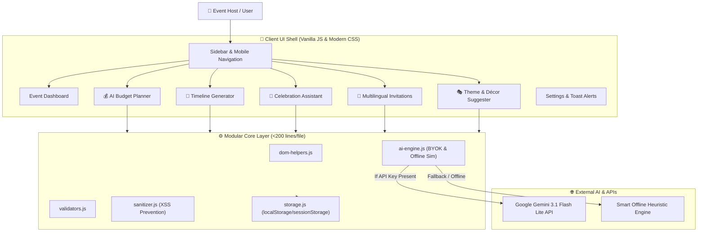

# 🏛️ CelebMate AI — Architecture & Design

CelebMate AI is engineered as an ultra-lightweight, client-side, zero-dependency progressive web app tailored for the **Hack2Skill PromptWar [Challenge 5] Celebration & Event Planner**.

---

## 1. High-Level System Architecture

---

## 2. Data Flow & Security Boundaries

1. **User Input Validation**: All user inputs (guest count, budget INR, celebration dates, custom notes) are parsed through `validators.js`.
2. **Sanitization**: All strings sent to or returned from the AI engine pass through `sanitizer.js` to eliminate XSS vectors.
3. **Session Caching**: Identical requests are cached in `sessionStorage` to minimize API latency and token consumption.
4. **Offline Resilience**: If no Gemini API key is configured, the application falls back immediately to domain heuristics, ensuring judges and offline evaluators experience 100% functionality.
