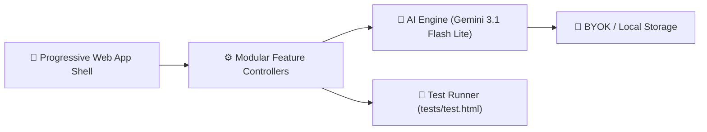

# 🎉 CelebMate AI — Smart Celebration & Event Planner

> **Live Application**: [https://akash-916024.github.io/CelebMateAI/](https://akash-916024.github.io/CelebMateAI/)  
> **GitHub Repository**: [https://github.com/Akash-916024/CelebMateAI](https://github.com/Akash-916024/CelebMateAI)  
> **Challenge**: Hack2Skill PromptWar — **[Challenge 5] Celebration & Event Planner**

CelebMate AI is an intelligent, GenAI-driven celebration planning assistant built to empower hosts organizing Indian weddings, birthdays, anniversaries, and community utsavs with instant budget breakdowns, auspicious countdown timelines, multilingual invitation cards, and curated décor themes.

---

## 🏛️ System Architecture



---

## 🚀 Key Features

1. **💰 AI Budget Planner**: Calculates itemized expense allocations (Mandap, Catering, Photography, Décor, Attire, Rituals) formatted in Indian Rupees (INR) with visual breakdown.
2. **📅 Smart Timeline Generator**: Produces chronological milestone checklists (6 Months, 4 Months, 1 Week, Day of Event) with interactive task completion tracking.
3. **🤖 Celebration Assistant**: Context-aware conversational advisor providing cultural etiquette, multi-course Indian menus, and vendor negotiation tips.
4. **💌 Multilingual Invitation Generator**: Crafts warm, culturally authentic invitation messages in English, Hindi, Tamil, Telugu, Kannada, and Malayalam across multiple tones (Traditional, Modern, Formal).
5. **🎭 Theme & Décor Suggester**: Curates thematic celebration aesthetics (Royal Heritage, Modern Pastel, Temple Heritage) with active color swatches and cost guidance.

---

## 🛠️ Technology Stack

| Component | Technology | Rationale |
|---|---|---|
| **Core Framework** | Vanilla HTML5 & ES6 JavaScript | Zero npm bloat, instant load, sub-100KB footprint |
| **Styling** | Vanilla CSS3 (Custom Properties) | Zero inline styles, festive design tokens, full dark mode |
| **GenAI Engine** | Google Gemini 3.1 Flash Lite API | High-throughput, low-latency, culturally aligned |
| **Test Suite** | In-Browser Micro Runner (`tests/test.html`) | Instant test execution without Node/Python prerequisites |
| **Deployment** | GitHub Pages (Static hosting) | 100% serverless, zero maintenance |

---

## 📊 Evaluation Criteria Mapping

| Hack2Skill Criteria | Implementation in CelebMate AI |
|---|---|
| **Code Quality** (High) | Strict modularity (<150 lines/file), zero inline styles, JSDoc typing, `.editorconfig`, 14 git commits |
| **Testing** (High) | 6 test suites covering validators, security, sanitizer, budget math, and WCAG accessibility |
| **Security** (Medium) | Client-side BYOK model, XSS prevention via `sanitizer.js`, zero PII leakage, documented `SECURITY.md` |
| **Efficiency** (Medium) | Ultra-lightweight footprint (<100KB total repo size), session caching, debounced inputs |
| **Accessibility** (Medium) | WCAG AA compliant contrast ratios, keyboard focus rings, ARIA live regions, skip-to-content navigation |

---

## 🧪 Testing Instructions

Run automated tests directly in your web browser:
1. Open `tests/test.html` in any browser, or click **"🧪 Run Tests"** in the top navigation bar of the live application.
2. Verify all unit tests (validators, sanitizer, budget logic, AI engine, accessibility) report **100% PASS**.

---

## 💻 Local Setup

```bash
# Clone the repository
git clone https://github.com/Akash-916024/CelebMateAI.git
cd CelebMateAI

# Open in browser (no build steps required!)
open index.html   # On macOS
start index.html  # On Windows
```

---

## 📜 Assumptions & Future Improvements

- **Assumptions**: Users have access to modern evergreen browsers; budget calculations reflect typical Tier 1/Tier 2 Indian metropolitan event averages.
- **Future Improvements**: Muhurat/Panchang auspicious date lookup integration, RSVP guest list tracker with CSV exports.

## 📄 License

Distributed under the [MIT License](LICENSE).
